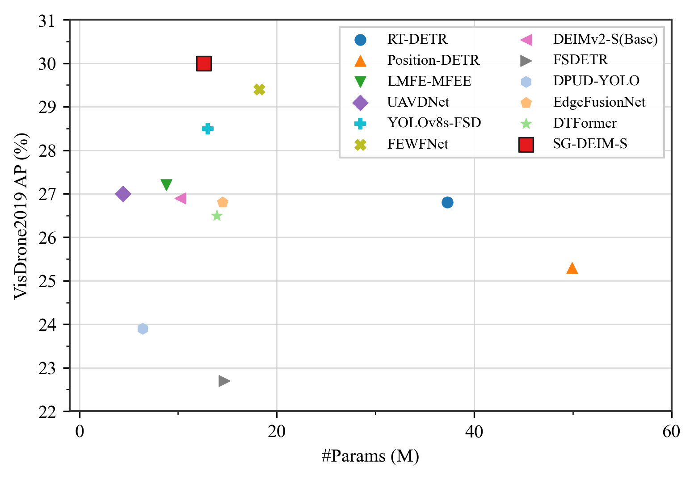

# Context-Guided Spectral Redistribution and Dual-Stage Gating for End-to-End Small Object Detection

SG-DEIM is an end-to-end detector designed for small object detection. It focuses on preserving weak small-object cues during feature extraction, reducing cross-scale interference during multi-scale feature fusion, and suppressing irrelevant attention-head responses during decoder query updating.

The framework consists of three main components:

- **Context-Guided Spectral Redistribution (CGSR):** enhances useful spectral information with adjacent-scale semantic guidance before encoder projection.
- **Cross-Scale Adaptive Interaction (CSAI):** performs bidirectional interaction between neighboring feature levels before multi-scale aggregation.
- **Query-Conditioned Attention Gating (QCAG):** adaptively filters attention-head responses according to the current object query before query updating.

SG-DEIM is evaluated on **COCO 2017**, **VisDrone2019-DET**, and **AI-TODv1**.

<p align="center">
  
  
</p>

---

## Environment

The experiments were conducted with the following environment:

- Ubuntu 22.04.5 LTS
- Python 3.11
- PyTorch 2.5.1
- CUDA 13.0
- NVIDIA GeForce RTX 4090

Create the environment and install the dependencies:

```bash
conda create -n sgdeim python=3.11.14 -y
conda activate sgdeim

git clone https://github.com/wudidekarma/SG-DEIM.git
cd SG-DEIM

pip install -r requirements-SGDEIM.txt
```

---

## Pretrained Weights

SG-DEIM uses pretrained backbone weights for model initialization.

| Model | Backbone | Pretrained Weight |
| --- | --- | --- |
| SG-DEIM-S | DEIMv2 ViT-Tiny | [vitt_distill.pt](https://drive.google.com/file/d/1YMTq_woOLjAcZnHSYNTsNg7f0ahj5LPs/view?usp=sharing) |
| SG-DEIM-M | DEIMv2 ViT-Tiny+ | [vittplus_distill.pt](https://drive.google.com/file/d/1COHfjzq5KfnEaXTluVGEOMdhpuVcG6Jt/view?usp=sharing) |
| SG-DEIM-L | DINOv3 ViT-S/16 | [DINOv3 Pretrained Models](https://github.com/facebookresearch/dinov3#pretrained-models) |
| SG-DEIM-X | DINOv3 ViT-S+/16 | [DINOv3 Pretrained Models](https://github.com/facebookresearch/dinov3#pretrained-models) |

Place the downloaded pretrained weights in the `ckpts/` directory:

```text
SG-DEIM/
└── ckpts/
    ├── vitt_distill.pt
    ├── vittplus_distill.pt
    ├── dinov3_vits16_pretrain_lvd1689m-08c60483.pth
    └── dinov3_vits16plus_pretrain_lvd1689m-4057cbaa.pth
```

Please make sure that `weights_path` in the corresponding configuration file matches the location of the pretrained checkpoint.

---

## Datasets

SG-DEIM is evaluated on three public object detection benchmarks.

| Dataset | Data Source |
| --- | --- |
| COCO 2017 | [COCO Official Website](https://cocodataset.org/#download) |
| VisDrone2019-DET | [VisDrone Official Repository](https://github.com/VisDrone/VisDrone-Dataset) |
| AI-TODv1 | [AI-TOD Official Repository](https://github.com/jwwangchn/AI-TOD) |

A recommended dataset directory structure is:

```text
data/
├── coco/
├── visdrone2019/
└── ai-tod-v1/
```

The corresponding dataset paths can be configured in:

```text
configs/dataset/
```

---

## Training

For example, SG-DEIM-S can be trained on COCO using two GPUs with:

```bash
CUDA_VISIBLE_DEVICES=0,1 torchrun \
  --standalone \
  --nproc_per_node=2 \
  train.py \
  --use-amp \
  --seed 0 \
  -c configs/sgdeim/sgdeim_dinov3_s_coco.yml
```

For other datasets or model scales, replace the configuration file with the corresponding configuration under:

```text
configs/sgdeim/
```

---

## Acknowledgments

This project is built upon the excellent open-source work of **DEIMv2**, **DEIM**, **D-FINE**, **RT-DETR**, and **DINOv3**.

We sincerely thank the authors of **COCO**, **VisDrone2019**, and **AI-TOD** for providing their datasets and evaluation resources.
