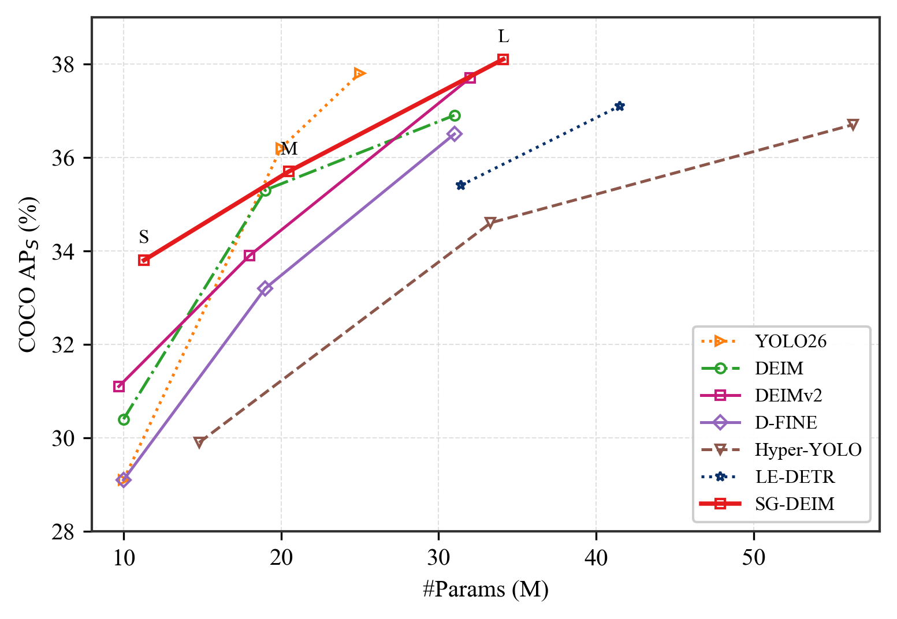

# Context-Guided Spectral Redistribution and Dual-Stage Gating for End-to-End Small Object Detection

SG-DEIM is an end-to-end detector designed for small object detection. It aims to preserve weak object evidence throughout the detection pipeline by regulating feature information at the **encoder input**, **multi-scale pyramid fusion**, and **decoder query updating** stages.

The framework contains three main components:

* **Context-Guided Spectral Redistribution (CGSR):** redistributes spectral magnitude responses over soft radial frequency bands using semantic context from adjacent feature scales, preserving useful small-object cues before encoder projection.
* **Cross-Scale Adaptive Interaction (CSAI):** performs bidirectional content-dependent modulation between aligned neighboring feature levels before pyramid aggregation, allowing fine spatial details and high-level semantic information to condition each other.
* **Query-Conditioned Attention Gating (QCAG):** generates query-dependent head-wise gates and applies them to the original self-attention and cross-attention responses before multi-head aggregation, reducing irrelevant information written into decoder query states.

SG-DEIM is evaluated on four public benchmarks: **COCO 2017**, **VisDrone2019-DET**, **AI-TODv1**, and **TinyPerson**, covering general object detection, dense UAV scenes, aerial tiny-object detection, and long-range pedestrian detection.

<p align="center">
  
  
</p>

<p align="center">
  <em>Parameter–accuracy comparison of SG-DEIM and representative detectors on COCO and VisDrone2019.</em>
</p>

---

## Environment

The experiments were conducted using the following environment:

* Ubuntu 22.04.5 LTS
* Python 3.11
* PyTorch 2.5.1
* CUDA 13.0
* Intel Core i9-14900KF
* 64 GB RAM
* 2 × NVIDIA GeForce RTX 4090

Create the environment and install the required packages:

```bash
conda create -n sgdeim python=3.11.14 -y
conda activate sgdeim

git clone https://github.com/wudidekarma/SG-DEIM.git
cd SG-DEIM

pip install -r requirements-SGDEIM.txt
```

---

## Pretrained Weights

SG-DEIM models are initialized with pretrained backbone weights.

| Model     | Backbone         | Pretrained Weight                                                                                         |
| --------- | ---------------- | --------------------------------------------------------------------------------------------------------- |
| SG-DEIM-S | ViT-Tiny         | [vitt_distill.pt](https://drive.google.com/file/d/1YMTq_woOLjAcZnHSYNTsNg7f0ahj5LPs/view?usp=sharing)     |
| SG-DEIM-M | ViT-Tiny+        | [vittplus_distill.pt](https://drive.google.com/file/d/1COHfjzq5KfnEaXTluVGEOMdhpuVcG6Jt/view?usp=sharing) |
| SG-DEIM-L | DINOv3 ViT-S/16  | [DINOv3 Pretrained Models](https://github.com/facebookresearch/dinov3#pretrained-models)                  |
| SG-DEIM-X | DINOv3 ViT-S+/16 | [DINOv3 Pretrained Models](https://github.com/facebookresearch/dinov3#pretrained-models)                  |

Place the downloaded checkpoints in the `ckpts/` directory:

```text
SG-DEIM/
└── ckpts/
    ├── vitt_distill.pt
    ├── vittplus_distill.pt
    ├── dinov3_vits16_pretrain_lvd1689m-08c60483.pth
    └── dinov3_vits16plus_pretrain_lvd1689m-4057cbaa.pth
```

Please ensure that `weights_path` in the corresponding configuration file points to the correct checkpoint.

---

## Datasets

SG-DEIM is evaluated using the official training and evaluation splits of four public datasets.

| Dataset          | Application                          |            Input Size | Data Source                                                                  |
| ---------------- | ------------------------------------ | --------------------: | ---------------------------------------------------------------------------- |
| COCO 2017        | General object detection             |             640 × 640 | [COCO Official Website](https://cocodataset.org/#download)                   |
| VisDrone2019-DET | Dense UAV object detection           | 640 × 640 / 800 × 800 | [VisDrone Official Repository](https://github.com/VisDrone/VisDrone-Dataset) |
| AI-TODv1         | Aerial tiny-object detection         |             800 × 800 | [AI-TOD Official Repository](https://github.com/jwwangchn/AI-TOD)            |
| TinyPerson       | Long-range tiny pedestrian detection |             640 × 640 | [TinyPerson / TinyBenchmark](https://github.com/w-sugar/TinyBenchmark)       |

A recommended dataset structure is:

```text
data/
├── coco/
├── visdrone2019/
├── ai-tod-v1/
└── tinyperson/
```

The corresponding dataset paths can be configured under:

```text
configs/dataset/
```

Please download each dataset from its official source and follow the corresponding dataset protocol when preparing annotations.

---

## Training

For example, SG-DEIM-S can be trained on COCO with two GPUs using:

```bash
CUDA_VISIBLE_DEVICES=0,1 torchrun \
  --standalone \
  --nproc_per_node=2 \
  train.py \
  --use-amp \
  --seed 0 \
  -c configs/sgdeim/sgdeim_dinov3_s_coco.yml
```

For other datasets or model scales, replace the configuration file with the corresponding configuration under:

```text
configs/sgdeim/
```

The training schedules used in the paper are:

* COCO: SG-DEIM-S / M / L / X are trained for **140 / 100 / 70 / 50 epochs**, respectively.
* VisDrone2019: **200 epochs**.
* AI-TODv1: **140 epochs**.
* TinyPerson: **120 epochs**.

---

## Acknowledgments

SG-DEIM is developed based on several excellent open-source object detection and representation-learning projects, including **DEIMv2**, **DEIM**, **D-FINE**, **RT-DETR**, and **DINOv3**.

We sincerely thank the authors and maintainers of **COCO**, **VisDrone2019**, **AI-TOD**, and **TinyPerson / TinyBenchmark** for providing the datasets, annotations, and evaluation resources used in this work.
